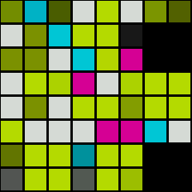

# Expectation Reality

**Generative percussion for the M-VAVE FM-1, a partner to [After Images](https://github.com/TheGrizard/After-Images).**
Press REC and it writes a groove: four parts (KICK, SNARE, PERC, HATS), each a pattern on its own length driving one
of eighteen synthesised drum engines. **Expectation** is the groove it deals, a loop that plays the same every time.
Turn up EVOLVE and it becomes **reality**: the groove's step components come in one by one, then it rewrites itself.

Free and open source (MPL-2.0). By [TheGrizard](https://github.com/TheGrizard), built on
[fm1-base](https://github.com/charlesvestal/fm1-base). Works on both FM-1 flash chips.

**[Install it in your browser](https://TheGrizard.github.io/Expectation-Reality/install/)** ·
**[User guide](https://TheGrizard.github.io/Expectation-Reality/manual/)** ·
[Try it in the emulator](https://TheGrizard.github.io/Expectation-Reality/emu/) ·
[Releases](https://github.com/TheGrizard/Expectation-Reality/releases)

## What makes it different

- **Always a kit, never the same groove.** REC deals four sounds, four patterns, a tempo, a palette, the effects and
  a name. IDM and machine-like first: Autechre, Boards of Canada, Burial, Objekt.
- **Polymeters.** The kick and snare hold the bar; the perc and hats loop on odd lengths (5, 7, 11, 13 ...), drifting
  against it and meeting again.
- **Generators.** A groove map that blends half-time, 2-step, electro and broken grooves; Euclidean rhythms; Turing
  machines for the hats; broken groupings of twos and threes.
- **Step components.** Like an Elektron's or an OP-Z's: ratchets, nudges, conditions (1:2, 3:4, FILL), probabilities,
  ghosts, open hats, pitches, accents. Each switches on at its own point on EVOLVE.
- **A groove that breathes.** Velocities shaped by the bar's weight, a drifting accent cycle and a slow swell; WARP a
  humaniser; fills that change the groove a little, and a FILL key.
- **Eighteen drum engines**: 808, MEMBRANE, BOX, FM KICK, CLAP, WIRES, GRAIN, CRACK, BENT (circuit-bent), MATERIAL,
  FM PERC, STRING, FOLEY (boxes, wood, footsteps, drags), METAL, DUST, DIGITAL, VOX, CLICK. WEIGHT sets a hit's
  fullness; ENTROPY its attack (a soft start, a click, a snap, a zap, a metal edge, a crushed stutter), carried
  through the whole hit; MOOD plays the kit heavy and long or bright and short.
- **Punch-ins on the white keys** (high-pass, a fill key, repeats, glitch, pitch down and up, tape mash, reverse, freeze, swell,
  crush, kill kick, low-pass; the repeats held to the grid) and **randomisers on the black keys** (each part's colours thrown at every hit).
- **The kit's bus.** Sends a part: REVERB, DELAY, PAN, COMP (all dry as dealt). A tape compressor with the kick wired to
  its sidechain (CLEAN or TAPE SMASH); a reverb that is ROOM, GATED, REVERSE or FREEZE, its size yours; a delay CLEAN or
  GRANULAR, with GLITCH. The mix balanced as After Images' is, and limited under -1 dBFS.
- **Plays with After Images.** Follows its MIDI clock to the beat and the bar and hears its notes: busier when it's
  busier, the kick leaning into GROUND, the perc in its key and answering LIGHT.
- **After Images' look.** The same pages, knobs and names, and its MATRIX turned inside out: every hit knocks a
  square out of the grid.

## Quick start

1. **Install.** Open the [web installer](https://TheGrizard.github.io/Expectation-Reality/install/) in Chrome or Edge
   on a computer, plug in the FM-1 by USB and follow the page.
2. **Listen.** It starts playing. **K1 to K4** set the four parts' levels.
3. **Press REC** for a new groove. Hold it for one in the same key and tempo.
4. **Hold HOME and turn K1 to K4** for the macros: MOOD, ACTIVITY, EVOLVE and DRIFT.
5. **Hold a white key** for a punch-in, **a black key** for a randomiser.
6. **SAVE** keeps a groove; ALGORITHM steps through your saved ones.
7. **Stop with PLAY before switching off**, and wait a few seconds: it then keeps your settings.

The [user guide](app/docs/MANUAL.md) has everything.

## Building

    git clone --recursive https://github.com/TheGrizard/Expectation-Reality
    ./build.sh --host              # the simulator
    sh tests/run_tests.sh          # the simulator's checks (any compiler warning fails them)
    make -C app/tools && app/tools/render 42 30 groove.wav    # a groove to a WAV, on the computer

Releases are built from source on GitHub (`.github/workflows/release.yml`), their packages signed with build
provenance, and the install site made from them (`site.yml`).

## Credits

Built on [fm1-base](https://github.com/charlesvestal/fm1-base) by Charles Vestal and
[felucca-bsp](https://github.com/hugelton/felucca-bsp) by Leo Kuroshita. After Images' app, effects and tests are its
starting point. Grids (Émilie Gillet) for the idea of a groove map; the Turing Machine (Music Thing Modular) for the
locked loop that can flip.
