# User guide

Expectation Reality turns the M-VAVE FM-1 into a generative drum machine. You don't program it step by step: you
press REC and it writes a groove, then you steer it. It plays on its own, and it is made to play under
[After Images](https://TheGrizard.github.io/After-Images/): it follows its tempo and listens to what it plays.

The name is the idea. **Expectation** is the groove REC deals: a fixed loop that plays exactly the same every time.
**Reality** is what happens when you turn EVOLVE up: up to halfway the groove bends into weirder loops that still
repeat; past it, it flows freely and rewrites itself.

## Contents

1. Quick reference
2. Installing
3. The first five minutes
4. The screen
5. The four parts
6. Steering a groove: the macros
7. Shaping a part: sound, groove, mix
8. The sounds
9. The grooves and their step components
10. Effects
11. Motion
12. Key, swing and tempo
13. The keys: punch-ins and randomisers
14. Saving your grooves
15. Playing with After Images
16. MIDI, sync and recording
17. When something's not right

---

## 1. Quick reference

| Control | What it does |
|---|---|
| K1 to K4 at home | the four parts' levels: KICK, SNARE, PERC, HATS |
| HOME held + K1 to K4 | MOOD, ACTIVITY, EVOLVE, DRIFT |
| HOME tapped at home | the FM-1's health: CPU, drops, saving |
| HOME elsewhere | back home |
| REC | a new groove (a new key too; one part's sound carried over; the tempo stays as you set it) |
| REC held | a new groove in the same key |
| SEL held + REC | the chosen part dealt afresh |
| OCT- / OCT+ held as you press a key, or tapped while you hold it | hold that punch-in or randomiser: to the loop's end (OCT-) or for good (OCT+) |
| OCT+ alone | let every hold go |
| HOME held + OCT- / OCT+ | back and forward through the grooves REC replaced |
| SAVE | keep the groove |
| ALGORITHM knob | step through saved grooves |
| PLAY | stop and start (from the top of the bar) |
| SEL, or SELECT knob | choose the part |
| PRESET knob | the chosen part's engine |
| EDIT | SOUND |
| SEQ | GROOVE |
| ENV | MIX |
| FX, again, again, again | SENDS, EFFECTS, TYPES, DELAY |
| LFO | MOTION |
| GLO, twice, three times | MACROS, SCALE, SCREEN |
| ARP, twice, three times | MIDI, CHANNELS, USB AUDIO |
| white keys | punch-in effects (section 13) |
| black keys | randomisers (section 13) |

## 2. Installing

You need a computer with **Chrome or Edge** and a USB cable for the FM-1.

1. Open the [installer](../install/) and plug the FM-1 in.
2. Follow the page: it finds the FM-1, checks it, and installs.
3. When it restarts, Expectation Reality plays.

To go back to the original firmware, or to After Images, install that the same way. Each firmware keeps its own
settings: switching doesn't mix them up.

## 3. The first five minutes

1. **Listen.** It starts playing a groove. Turn **K1 to K4** to set KICK, SNARE, PERC and HATS.
2. **Press REC.** A new groove: new sounds, new patterns and colours, at the same tempo. One part keeps its sound from
   the groove before (its SOUND and MIX settings, with a new pattern), so a run of grooves flows like a set: the
   popup says which. Press it a few times.
3. **Hold HOME and turn K3 (EVOLVE).** At 0 the groove loops exactly. Turn it up and the groove's hidden details come
   in one by one: ratchets, ghost notes, nudges, conditions. Past about 70 it starts rewriting itself.
4. **Hold a white key.** The second white key from the bottom repeats the last beat; the ones in the middle pitch
   it down and up; the bottom key is a high-pass filter, the top one a low-pass.
5. **Hold a black key.** Each hit of that part gets a new random colour while you hold it.
6. **SAVE** a groove you like. Stop with **PLAY** before switching off, and wait a few seconds: it keeps your
   settings.

## 4. The screen

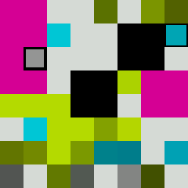

At home the whole screen is a grid of squares in four colours, one for each part. Every hit knocks a square out of
the grid, somewhere at random, and it grows back in that part's colour, as fast as the sound dies away: a hat
blinks, a tom leaves a hole that slowly fills. Whole squares fill their cells and meet their neighbours edge to edge,
so the colours lie in solid fields. Loud kicks and snares knock out a block of four. So the hits slowly
repaint the grid: a groove heavy with hats drifts towards their colour. Each REC lays the grid out afresh in a new
palette.

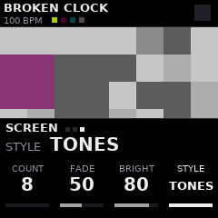

SCREEN's **STYLE** (GLO three times) has a second look, **TONES**: the squares in shades from dark grey to white
(each part's grey the shade closest to its colour's own lightness, each square a little either side of it), and a hit floods its square with the
part's colour, fading back to its grey. The palettes still change with each REC, so the colours come and go over the
same tonal layout.

On the other pages the top shows the groove's name, its tempo and four lights (the parts, as they play), and in the
top right corner a square that flashes on every beat: white, and in the kick's colour on the bar's downbeat. The
punch-ins start on the next beat, so it shows you where they'll land. The bottom shows the page's four settings, After Images' way: the one you turn last shows big.

## 5. The four parts

Expectation Reality is always a kit:

- **KICK** (red in the classic palette): the low end. Always dry and in the middle; it also drives the compressor.
- **SNARE**: the backbeat and its ghosts.
- **PERC**: tuned percussion, playing notes in the groove's key (or After Images').
- **HATS**: the top: hats, shakers, crackle, digital noise.

Each part has its own pattern on its own length. The kick and snare usually run in bars of 16 or 32 steps; the perc
and hats run on odd lengths (5, 7, 9, 11, 13 steps) so they drift against the bar and meet again: polymeters.

## 6. Steering a groove: the macros

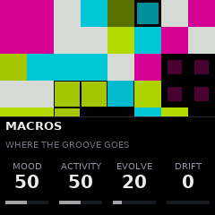

Hold **HOME** and turn K1 to K4 (they're also on GLO's first page):

- **MOOD**: how the hits are played. To the left, heavy, long, full and soft, darker; to the right, bright, short,
  hard and staccato. In the middle a mix: each part is dealt its own place between the two (some tight, some ringing), and
  every hit varies a little around it. The kick moves least: never much shorter than as dealt.
  The mix stays balanced across MOOD: each part is held at the same loudness against the others at every setting,
  and the whole kit at about the same level (After Images' balance: see section 10).
- **ACTIVITY**: how much of each pattern plays. At 0, stripped back: each part's core (about two kicks and two snares a
  bar, a perc and a couple of hats). Turned up, each part's next strongest hits come in, in order, to a full but never
  frantic groove at 100. The kick stays firm however high it goes (a few more hits a bar at most, never rolling).
- **EVOLVE**: expectation to reality, in two halves.
  - **0 to 50: weirder, but fixed.** At 0 the groove loops exactly as dealt. Turning up brings in each step's
    component (see section 9) at its own point on the knob, and neighbouring sixteenths start trading places. Every
    one of these choices is the same each time round (a cycle of four passes of each part's pattern), so however
    weird it gets, it is still a loop that repeats exactly.
  - **50 to 100: free-flowing.** Just past 50 it starts to wander, gently: some choices left to chance, a pattern
    rewriting a step now and then, a beat now and then played from another part of the pattern. All of it grows to
    100, where nothing repeats and the patterns rewrite themselves every bar. SAVE keeps how far the rewrites have got.
  - **KICK and SNARE** keep their groove for longer: they ignore EVOLVE from 0 to 25 and again from 50 to 75, take
    their fixed variations from 25 to 50 and their free flow from 75 to 100. PERC and HATS evolve all the way. The kick
    stays the anchor throughout: EVOLVE gives it accents, ghosts and hits that come and go on a cycle, but never
    pushes, rolls, drops, moves or rewrites it.
  - For an exact loop, keep CHAOS (MOTION) at 0 too: its rolls and skips are random whatever EVOLVE says.
- **DRIFT**: the mixer. At 0 everything plays as set. Turned up, parts fade out for a few bars and come back (never
  fewer than two playing).

## 7. Shaping a part: sound, groove, mix

Choose the part with **SEL** (or the SELECT knob), then:

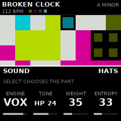

**EDIT: SOUND**: ENGINE · TONE · WEIGHT · ENTROPY.

- **ENGINE**: which drum engine (section 8). The PRESET knob changes it from any page.
- **TONE**: After Images' DJ filter: at 12 o'clock open; to the left a low-pass closing down; to the right a
  high-pass going up.
- **WEIGHT**: the hit's fullness: light and short to heavy, long and driven. It also spreads the attack (below):
  longer, lower and wider as it rises.
- **ENTROPY**: mostly the hit's attack, its first moments, where most of a drum's feel is. As it rises the attack
  changes kind, each fading into the next: a softened start (no edge at all), a click, a noise snap, a zap (a tone
  diving from high), a metallic ring-modulated edge, and at the top a crushed stutter. Each leaves its mark on the
  rest of the hit too, so a long hit keeps its character to the end: the click leaves the body ringing, the snap a
  rasp, the zap keeps diving, the ring and the crush stay, lighter. The attack stretches as the hit gets longer
  (DECAY, MOOD). ENTROPY still changes each engine's body a little, in its own way (FOLEY's and BENT's a lot: see
  section 8). The level stays steady as it moves.

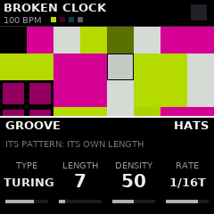

**SEQ: GROOVE**: TYPE · LENGTH · DENSITY · RATE.

- **TYPE**: what writes the pattern: MAP (a map of grooves, from half-time to 2-step, electro and broken),
  EUCLID (Euclidean rhythms), TURING (a Turing machine: a loop that can flip as it goes), BROKEN (IDM groupings of
  twos and threes).
- **LENGTH**: its length in steps, 3 to 32.
- **DENSITY**: this part busier or sparser than ACTIVITY has the rest.
- **RATE**: its steps, slow to fast: 1/8, 1/8T, 1/16, 1/16T, 1/32.

**ENV: MIX**: LEVEL · DECAY · PITCH · PAN. DECAY makes every hit longer or shorter than it was dealt; PITCH tunes the
part in semitones.

## 8. The sounds

Eighteen engines, four or five for each part, every one shaped by WEIGHT and ENTROPY (and made harder or softer,
brighter or darker by MOOD). Any engine can be chosen for any part, and plays in that part's register: a snare's or a hat's engine on the kick
drops to a kick's depth (STRING only to about 86 Hz, made duller there). REC deals from each part's own:

| Part | Engine | What it is | ENTROPY turns it |
|---|---|---|---|
| KICK | 808 | a soft, round kick: a sine, a gentle fall, a softened front | dust, a deeper fall, warmth |
| KICK | MEMBRANE | a struck skin: a falling sine and a drumhead's off-pitch modes | into a growl, the modes bent |
| KICK | BOX | a thump in a box: noise ringing two falling resonances | ringing, then rising instead of falling |
| KICK | FM KICK | two operators, the pitch falling | off the harmonics, fed back on itself |
| SNARE | CLAP | a synthesised clap: bursts of noise a few ms apart and a tail | the bursts loosened and roughened |
| SNARE | WIRES | a body and its wires (noise through a short comb) | the wires ringing into metal |
| SNARE | GRAIN | a cluster of tiny noise bursts | scattered into a stutter, each grain its own pitch |
| SNARE | CRACK | a click ringing three resonances | the resonances pulled apart, glassy |
| SNARE | BENT | a circuit-bent toy: two oscillators wired into each other, pitch jumps, a broken sample rate | rewires it: every WEIGHT and ENTROPY setting its own wild sound |
| PERC | MATERIAL | a struck bar, dull and short | from wood to clay to glass |
| PERC | FM PERC | FM blips with a snap of a pitch fall | inharmonic, fed back, decimated |
| PERC | STRING | a struck string | struck sharp and settling, its overtones stretched |
| PERC | FOLEY | found sounds: a box banged, a plank of wood, a footstep, something dragged | from one to the next (between two, each hit either) |
| HATS | METAL | six square waves at metal's ratios | towards the groove's own ratios, ring-modulated |
| HATS | DUST | crackle: noise in sparse grains | pitched grains, smeared like a shaker |
| HATS | DIGITAL | noise at a low sample rate and few bits | the rate jittering, the bits falling, a loop that sings |
| HATS | VOX | almost a voice: breath and a buzz through vowel formants, very short | wider pitch jumps, the vowel sliding |
| HATS | CLICK | impulse clicks through a resonance | a ping whose tone moves hit to hit, then bursts of clicks |

The perc plays low, in the octave just above the kick (C2 to B2, in the groove's key). Every engine is short and
staccato as dealt; REC deals WEIGHT mostly low. MIX's DECAY and MOOD make them longer.

Every hit is also shaped by how hard it is: harder hits are a little brighter and heavier, as a real drum is.

## 9. The grooves and their step components

REC writes each part's pattern as steps. Every step has a level (how much it belongs: ACTIVITY decides which play)
and a velocity, and many carry one **component**, like an Elektron or OP-Z step:

- **RATCHET**: the hit rolled into two, three or four.
- **NUDGE**: the hit pushed early or late by a fraction of a step.
- **CONDITION**: plays only on some passes of the loop: 1:2, 2:2, 1:4, 3:4, on FILL bars (every fourth bar), or not.
- **PROBABILITY**: plays only sometimes.
- **GHOST**: a quiet extra hit on an empty step.
- **OPEN / OTHER**: the hats' open hat, the snare's short hit, the perc an octave up.
- **PITCH**: a different note or tuning.
- **ACCENT**: harder.

Each component has its own point on EVOLVE where it switches on: the steady ones (nudges, accents, conditions) early,
chance late. So EVOLVE brings a groove's detail in gradually, and a groove at the same EVOLVE always plays the same
components. Up to 50 even the chances (PROBABILITY) come out the same every time round; past 50 they're dice again.

The velocities have a shape of their own, dealt by REC: the bar's weight (the one strongest, then three, then two and
four, the offbeats softest; the kick leaning on it most), an accent every three, five or seven sixteenths drifting
across the bar, and a slow swell over a few bars.

Every eight bars (every four, EVOLVE well up) a fill may come on the last beat: the kick steps out, the perc and hats
get busier, the snare plays a little variation, then the groove comes back. The FILL key (section 13) plays one whenever you like.

## 10. Effects

There are three effects pages, and the keys have their own (section 13).

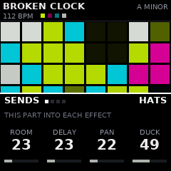

The three pages keep the same order: REVERB, DELAY, PAN, COMP.

**FX: SENDS**, for the chosen part: REVERB · DELAY · PAN · COMP. How much of the part goes into each effect. COMP is how
much of it goes through the compressor, which always listens to the kick: whatever you send pumps under the kick (that
replaces DUCK). Every part starts dry when REC deals a groove: the effects are yours to add, the kick's too.

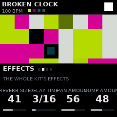

**FX again: EFFECTS**, the whole kit's: REVERB SIZE (how big the room is, how long it rings) · DELAY TIME (1/4 down
to 1/128, where it turns into a pitched buzz) · PAN AMOUNT · COMP AMOUNT (how hard it works). How much of each part
reaches the reverb and delay is set by its sends. The reverb and the delay dip lightly under each kick (a few dB,
back within an eighth of a second), FREEZE's wash too, so the kick always cuts through the tails.

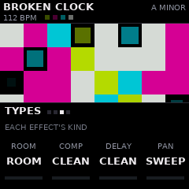

**FX a third time: TYPES**, each effect's kind, in the same order:

- **REVERB TYPE**: ROOM (a plain space), GATED (cut off in time: its pre-delay and gate follow the tempo), REVERSE (the
  room's sound played backwards, swelling into the hits), FREEZE (an endless wash).
- **DELAY TYPE**: CLEAN or GRANULAR (dirty: grains of the echo, some an octave up or down).
- **PAN TYPE**: SWEEP (the parts drifting across over two bars), SPIN (round you every eighth), SCATTER (each hit thrown
  somewhere new).
- **COMP TYPE**: CLEAN (glue) or TAPE SMASH (squashed into tape, pumping off the kick; extreme turned right up).

**FX a fourth time: DELAY**: FEEDBACK, GLITCH (how often the time jumps to another, every sixteenth: Autechre's
stutter).

**The balance** (always on, as After Images has it): each part is held at the same loudness against the others at
every MOOD (measured in the simulator, weighted as the ear hears it), the mix's tone tilts slowly towards a steady
top-to-bottom, and a leveller keeps every groove at about the same loudness. At the very end a limiter holds the
output under -1 dBFS, so the speaker, the line out and a recorder are never driven past full scale. The volume knob
at full, or USB AUDIO's GAIN at 100, is unity.

## 11. Motion

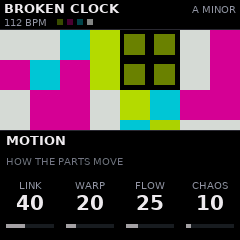

**LFO: MOTION**: LINK · WARP · FLOW · CHAOS, After Images' names:

- **LINK**: how much the parts, and After Images, answer each other: the hats keep out of the kick's way, the kick
  leans into After Images' bass notes, the perc answers its melody.
- **WARP**: the humaniser: every hit's timing loosened and its velocity varied, with a player's lean (the snare a
  touch late, the hats a touch early).
- **FLOW**: each part's sound slowly wandering.
- **CHAOS**: rolls, skipped hits and hits pushed off the grid, at random (never the kick's).

## 12. Key, swing and tempo

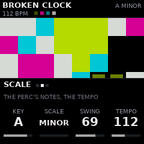

**GLO again: SCALE**: KEY · SCALE · SWING · TEMPO. KEY and SCALE are the perc's notes. SWING delays the off
sixteenths (REC deals it: mostly straight). TEMPO is yours: 100 BPM at every power-on, and REC never changes it, so it
holds while you play live. A saved groove keeps its own tempo: recall it and it comes back at that tempo, and REC
goes on from there (going back through history likewise). Shown as IN
while it follows a clock.

## 13. The keys: punch-ins and randomisers

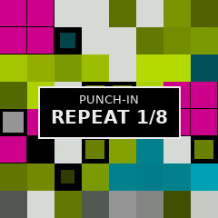

**The white keys are punch-in effects** on the whole sound, while you hold them. From the bottom:

| Key | Punch-in |
|---|---|
| 1 (bottom) | HIGH-PASS, from about 350 Hz; press harder for more |
| 2 | FILL: from the next beat, for a bar (held, for as long as you hold it): a contrast, the kick on the downbeat alone, the perc and hats busier (ACTIVITY low) or back to their core hits (ACTIVITY high) |
| 3 | REPEAT 1/8 |
| 4 | REPEAT 1/12 (triplets) |
| 5 | REPEAT 1/16 |
| 6 | REPEAT 1/32 |
| 7 | GLITCH: everything as it plays, chopped: each sixteenth let through, repeated (a 16th, 32nd, 64th or triplet) or played backwards |
| 8 | PITCH DOWN an octave |
| 9 | PITCH UP an octave |
| 10 | TAPE MASH: a chewed tape, held: wobbling, catching, saturated and dull, with dropouts; press harder for more |
| 11 | REVERSE: everything as it plays, backwards: each eighth (a sixteenth at slower tempos) played backwards as the next comes in |
| 12 | FREEZE: a moment of the whole kit caught in the room and held as an endless wash, the groove going on over it; held, caught anew each bar |
| 13 | SWELL: the latest strong hit played backwards, swelling into the next beat; held, into every beat |
| 14 | CRUSH |
| 15 | KILL KICK |
| 16 (top) | LOW-PASS, from about 1.5 kHz, a gentle slope; strike it harder for more |

FILL plays alongside the punch-ins and filters. A fill is a contrast, a simple change of the groove, not a roll: the
kick steps out (only the bar's downbeat, if the fill reaches one) and the snare plays a slight variation of its own.
With ACTIVITY low, the perc and hats bring in more of their own patterns (on the sixteenths, never rolled or speeding
up); with ACTIVITY high, they drop back to their core hits, a breakdown; in between, each fill goes one way or the
other at random. Then the groove comes back as it was. Each fill is a different variation.

None of them goes silent if you press between the hits. The repeats loop one piece of sound and hold it: if the slice
you pressed on has no hit in it, they take the nearest one before it on the same grid that has, or listen on to the
next slice with a hit (so they stay in time). GLITCH and REVERSE work like CRUSH: on everything as it plays, the beat
going on through them, so MOOD and everything else still change what you hear. FREEZE catches the whole kit's last
half beat, kick included, or, if that was between hits, listens on until it catches one; it holds through any REVERB
TYPE, GATED included. SWELL finds the latest strong hit and plays it backwards, landing on the beat. Held (or held with
OCT- or OCT+), FREEZE catches a new moment at each bar and SWELL swells into every beat.

**On the beat.** While it plays, a punch-in waits for the next beat to start (pressed up to a sixteenth late, it starts
at once), so a loose press still lands in time, and ends the moment you let go (FREEZE's wash gone within about a
quarter of a second). A quick tap let go before
its beat still plays, a sixteenth's worth. SWELL keeps its own timing (it lands on the beat), the two filters work
the instant you press, and stopped, everything is instant.

The repeats are held to the grid: however late you press, the loop starts on a line of its own grid (an eighth, a
sixteenth...) and repeats in time with the groove. GLITCH and REVERSE keep to the grid from the beat they start on.

**Holds.** Hold **OCT-** as you press a key, or hold the key and tap OCT-, and it stays on to the end of the loop
(the kick's pattern, at least a beat away); **OCT+** the same way and it stays on for good. Either order works, for
the white keys and the black. A held key stays lit. Press it again to let it go,
or press OCT+ on its own to let every hold go. One punch-in plays at a time (pitch up and down would cancel, two loops
would fight), so holding a new one lets go of the one held before; the two filters can be held alongside it, and any
number of black keys. While a punch-in is held, pressing another plays that one for as long as you press it. The latest key held plays; the two filters work alongside
the others. Everything fades in and out over a few milliseconds, so nothing clicks.

**The black keys are randomisers.** While you hold one, every hit of its part takes a new random value of one of its
SOUND settings, and holds it until the next hit (sample and hold). Press harder for wilder values. By the black keys'
groups, low to high:

| Keys | Randomise |
|---|---|
| the first three | KICK's TONE, WEIGHT, ENTROPY |
| the next two | SNARE's WEIGHT, ENTROPY |
| the next three | PERC's TONE, WEIGHT, ENTROPY |
| the next two | HATS' WEIGHT, ENTROPY |
| the last one | every part's TONE, WEIGHT and ENTROPY |

## 14. Saving your grooves

**SAVE** keeps the groove playing (up to 16); **ALGORITHM** steps through them. If you've changed a saved groove,
its name shows a star. EVOLVE's rewrites are part of a groove, so SAVE keeps them too.

Your settings and the groove playing are kept by themselves once you stop with **PLAY**: after a few seconds of
silence (writing to the FM-1's memory interrupts the sound, so it never does it while playing). Updates keep
everything you've saved.

## 15. Playing with After Images

Expectation Reality listens to After Images' notes: After Images sends each layer on its own channel (GROUND 1,
BODY 2, LIGHT 3, DUST 4), and Expectation Reality hears them (ARP: MIDI, LISTEN on; CHANNELS, LISTEN CH 1-4).

- the busier After Images is, the busier the drums (with LINK up)
- the kick leans into GROUND's bass notes
- the perc plays in the key GROUND is in (ARP again: CHANNELS, FOLLOW on), and now and then answers LIGHT's melody

**Connecting them.** The FM-1 sends MIDI over USB only, so two FM-1s need something in between to talk:

- **a computer, an iPad (AUM) or another USB host**: route After Images' MIDI (clock and notes) to Expectation
  Reality. On After Images set CLOCK OUT and NOTES OUT; on Expectation Reality CLOCK IN and LISTEN on.
- **an Ableton Move or other clock**: both FM-1s can follow its clock (CLOCK IN on both); then they play in time,
  though Expectation Reality won't hear After Images' notes.

A direct link through a powered USB hub (this FM-1 as the host) is planned; it needs testing on hardware first.

## 16. MIDI, sync and recording

**ARP: MIDI**: CLOCK · NOTES OUT · LISTEN · CC IN.

- **CLOCK**: INT (its own tempo), IN (following another device's clock, locked to its beats and bars; its Start
  and Stop obeyed), OUT (leading: sending its clock, Start and Stop).
- **NOTES OUT**: every hit sent as a MIDI note on OUT CH (channel 10 by default): kick 36, snare 38, perc its own
  note, closed hat 42, open hat 46.
- **LISTEN**: After Images' notes heard.
- **CC IN**: CC 20-23 move the macros, 24-27 the effects (REVERB SIZE, DELAY TIME, PAN AMOUNT, COMP AMOUNT), 28-31 MOTION.

**ARP again: CHANNELS**: LISTEN CH (the four channels After Images' layers come on), OUT CH, FOLLOW (the perc's key
from After Images' GROUND).

**ARP a third time: USB AUDIO**: OUTPUT · CONTROL · GAIN, as After Images has it. Plugged into a computer the FM-1 is
a stereo audio input.

- **OUTPUT**: MIX, the kit as you hear it; or CLEAN, the kit without FX's effects (no REVERB, DELAY, PAN or COMP),
  to record dry and add your own. CLEAN goes to the speaker too, so you hear what's recorded; the switch glides, so it
  never clicks. The punch-ins still play.
- **CONTROL**: MASTER (the recording follows the volume knob) or FIXED (at GAIN, whatever the volume knob says).
- **GAIN**: the level with CONTROL at FIXED; 100 is unity, never past -1 dBFS.

## 17. When something's not right

- **No sound**: is it stopped (STOPPED on the screen)? Press PLAY. Are the levels at home turned up?
- **Following a clock and nothing plays**: with CLOCK IN it waits for the leader's Start. Press play on the
  leader, or set CLOCK to INT.
- **The perc sounds out of key with After Images**: set the same KEY and SCALE (GLO again), or turn FOLLOW on.
- **It seems busy or tired, or crackles**: tap HOME at home: it shows the processor's load, any audio drops (each
  drop is a crackle) and 2 CORES or 1 CORE. Drops climbing? Tell me what it shows, the groove and the settings.
- **At power-on**: it stays silent until it has read the volume knob, then fades in, so with the volume down nothing
  comes through.

Expectation Reality is free and open source (MPL-2.0), by TheGrizard, built on fm1-base by Charles Vestal.
