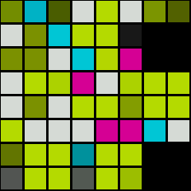

# Expectation Reality

**Generative percussion for the M-VAVE FM-1.** Press REC and it writes a groove: four parts (KICK, SNARE, PERC, HATS),
each a pattern on its own length driving a synthesised drum engine. **Expectation** is the groove it deals, a loop
that plays the same every time. Turn up EVOLVE and it turns into **reality**: to halfway the groove bends into weirder loops, past it it flows freely
and rewrites itself.
Made to play under [After Images](https://TheGrizard.github.io/After-Images/).

**Version {{VERSION}}** · **[Install it](install/)** · **[User guide](manual/)** · [Play it in your browser](emu/) ·
[Source](https://github.com/TheGrizard/Expectation-Reality)

## What it does

- **One button, a whole groove:** four sounds (one carried over, for a set that flows), four patterns, effects, a
  palette and a name; the tempo stays yours.
- **Polymeters:** the kick and snare hold the bar while the perc and hats loop on odd lengths, drifting against it.
- **Generators, not dice:** a groove map, Euclidean rhythms, Turing machines and broken IDM groupings; or other
  personalities: FLOORS' four on the floor, CLOUDS' soft micro-sounds, IMPLODE's dusty boom-bap.
- **Step components:** ratchets, nudges, conditions, probabilities and ghosts, brought in by EVOLVE one at a time.
- **Eighteen drum engines:** a soft 808, struck skins, resonant boxes, FM, claps, wires, grains, cracks, a circuit-bent
  toy, wood and glass, strings, foley (boxes, wood, footsteps, drags), metal clusters, crackle, digital noise, an
  almost-vocal hat and impulse clicks. WEIGHT sets the fullness, ENTROPY the attack, MOOD heavy and long to bright
  and short.
- **Punch-ins on the keys:** filters, a fill key, repeats held to the grid, glitch, pitch up and down, tape mash, reverse, freeze, swell, crush; on the beat, with a beat light to time them by.
- **Randomisers on the black keys:** every hit of a part thrown somewhere new while you hold one.
- **A kit bus:** a kick-sidechained tape compressor, a room that gates, reverses and freezes, a glitch delay, pans.
- **A partner to After Images:** follows its clock to the beat and bar and listens to its notes.

## Quick start

1. Open the [installer](install/) in Chrome or Edge on a computer, plug in the FM-1 by USB and follow the page.
2. It starts playing. **K1 to K4** set KICK, SNARE, PERC and HATS.
3. **REC** for a new groove; **held**, a new groove in the same key.
4. **Hold HOME and turn K1 to K4** for the macros: MOOD, ACTIVITY, EVOLVE and DRIFT.
5. **Hold a white key** for a punch-in; **a black key** for a randomiser.
6. **SAVE** keeps a groove; ALGORITHM steps through your saved ones.
7. **Stop with PLAY before switching off**: a few seconds later it keeps your settings.
